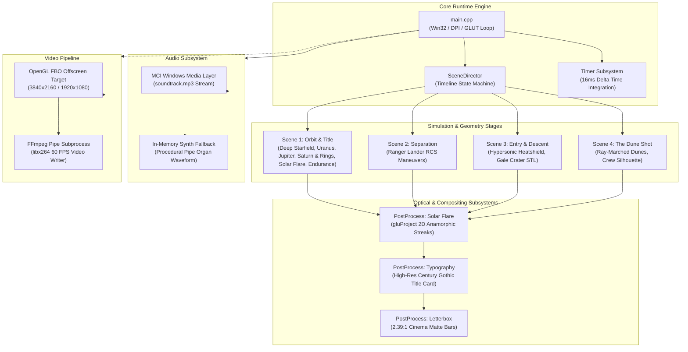
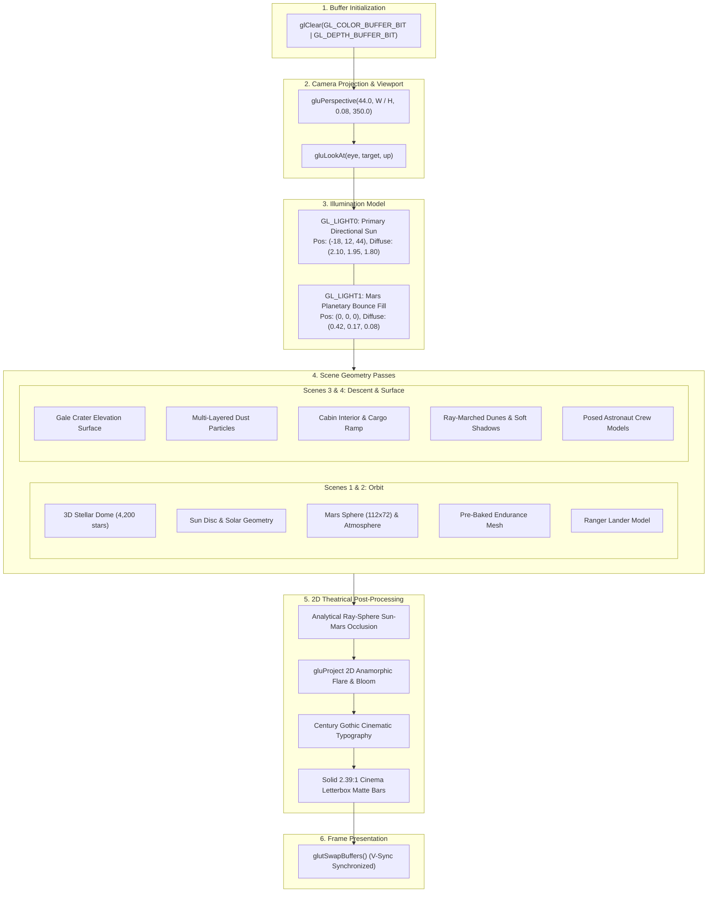
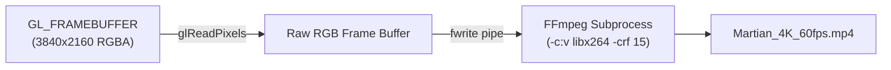
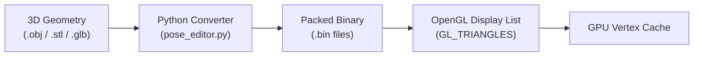

# MARTIAN: Cinematic Space Sequence Engine

A high-performance, native C++ / OpenGL real-time cinematic visualizer and animation sequence recreating the Interstellar and Gravity-grade journey from deep cosmic orbit to hypersonic entry and touchdown on the Martian surface.

> **Pre-compiled Binary**: Download [**Martian_v1.0.zip**](https://github.com/imMohammedSahil/Martian/releases/latest/download/Martian_v1.0.zip) from [Releases](https://github.com/imMohammedSahil/Martian/releases), extract, and run `Martian.exe` directly on Windows without compiling. *(On first run, click **More info** → **Run anyway** if Windows SmartScreen prompts).*

The engine executes an uninterrupted, frame-accurate 84.3-second cinematic sequence rendered in an anamorphic 2.39:1 theatrical letterbox, powered by procedural solar lens flare projection, multi-scattering atmospheric illumination, fast ray-marched terrain shadows, dual-stream spatial audio, and an offscreen frame-buffer video recording pipeline.

---

## Technical Specifications

| Parameter | Specification | Details |
| :--- | :--- | :--- |
| **Language & Standard** | C++17 | ISO/IEC 14882:2017 compliant |
| **Rendering API** | OpenGL 2.1 / Compatibility Profile | Fixed-function and programmable pipeline integration via FreeGLUT |
| **Target Platforms** | Windows 10 / Windows 11 (64-bit) | Win32 / WGL subsystems |
| **Window Subsystem** | FreeGLUT 3.0+ | Statically linked (`-DFREEGLUT_STATIC`) |
| **Display Mode** | 2.39:1 Cinema Letterbox | Fullscreen borderless with Win32 DPI awareness |
| **Target Refresh Rate** | 60 FPS (V-Sync synchronized) | Sub-millisecond `glutTimerFunc` frame pacing |
| **Audio Subsystem** | WinMM (`mmsystem.h`) + MCI | Hardware-accelerated streaming MP3 with procedural dual-channel synth fallback |
| **Texture Management** | `stb_image` (Sean Barrett) | Auto mipmapped via `gluBuild2DMipmaps`, GL_LINEAR filtering |
| **Geometry Representation**| Pre-baked packed binary meshes (`.bin`)| Custom binary vertex format with normal, UV, and color payloads |
| **Export Subsystem** | Offscreen FBO (GL_FRAMEBUFFER_EXT) | Raw RGB pipe into FFmpeg (H.264 / AAC 60 FPS) |

---

## System Architecture

The runtime architecture separates timeline sequencing, physical camera interpolation, geometry simulation, procedural post-processing, and audio playback into modular compilation units.



---

## Sequence Choreography & Timeline

The 84.3-second narrative unfolds across four distinct cinematic phases without manual scene cuts:

```mermaid
stateDiagram-v2
    [*] --> Scene1 : T = 0.0s
    state Scene1 {
        [*] --> CosmicVoid : 0.0s - 4.5s
        CosmicVoid --> MarsReveal : 4.5s - 13.0s
        MarsReveal --> DiveToOrbit : 13.0s - 22.0s
        DiveToOrbit --> TitleReveal : 22.0s - 35.0s
    }
    Scene1 --> Scene2 : T = 35.0s
    state Scene2 {
        [*] --> RangerUndocking : 35.0s - 39.0s
        RangerUndocking --> InjectionBurn : 39.0s - 44.0s
    }
    Scene2 --> Scene3 : T = 44.0s
    state Scene3 {
        [*] --> PlasmaBowShock : 44.0s - 52.0s
        PlasmaBowShock --> GaleCraterDive : 52.0s - 58.0s
        GaleCraterDive --> ParachuteLanding : 58.0s - 65.0s
    }
    Scene3 --> Scene4 : T = 65.0s
    state Scene4 {
        [*] --> CabinDarkness : 65.0s - 68.0s
        CabinDarkness --> RampLowering : 68.0s - 72.0s
        RampLowering --> DuneSilhouettes : 72.0s - 76.9s
    }
    Scene4 --> Finale : T = 76.9s
    state Finale {
        [*] --> CutToBlack : 76.9s - 78.8s
        CutToBlack --> WhiteTitleCard : 78.8s - 84.3s
    }
    Finale --> [*] : Sequence Complete (Loop)
```



### Detailed Sequence Breakdown

| Shot | Timecode | Camera Movement & Lens | Visual Mechanics & Assets | Audio Cue |
| :--- | :--- | :--- | :--- | :--- |
| **1.1** | `00.0s - 04.5s` | Slow pan in deep space; 44 deg FOV | 4,200 twinkling stars; distant pale cyan ice giant Uranus; pitch void | Low-frequency sub-bass drone |
| **1.2** | `04.5s - 13.0s` | Orbit acquisition & celestial sweep | Panning past banded giant Jupiter; Mars centered in frame with Saturn & illuminated 8K alpha rings at bottom-right; Endurance rotating speck | Rising chord progression |
| **1.3** | `13.0s - 22.0s` | High-speed descent `Z: 12.0 -> 3.12` | Mars surface expands to cover 100% viewport | Dynamic orchestral swell |
| **1.4** | `22.0s - 35.0s` | Heroic tracking orbit | Authentic 12-pod Endurance ring with beacon strobes; `MARTIAN` title at `27.0s` | Peak pipe organ crescendo |
| **2.1** | `35.0s - 39.0s` | Over-the-shoulder lander view | Ranger decoupling from hub; cold-gas RCS puffs | Thruster burst SFX |
| **2.2** | `39.0s - 44.0s` | Side-profile cruise towards horizon | Twin rear de-orbit engines firing; receding towards planet | Main de-orbit burn hum |
| **3.1** | `44.0s - 52.0s` | Leading hypersonic chase camera | Ionized plasma bow shock, thermal emissive glow, flame particles | High-velocity wind shear |
| **3.2** | `52.0s - 58.0s` | Low-altitude terrain pass | NASA Gale Crater terrain mesh (`gale_crater.bin`), dust haze | Atmospheric drag roar |
| **3.3** | `58.0s - 65.0s` | Deceleration track | Supersonic parachute deployment, retro-thrusters, dust plumes | Touchdown retro pulse |
| **4.1** | `65.0s - 68.0s` | Interior cabin perspective | Dark metallic cabin with interior floodlight | Ambient cabin hum |
| **4.2** | `68.0s - 72.0s` | Cargo ramp descent | External solar bloom flooding cabin; mechanical ramp rotation | Ramp servo whine |
| **4.3** | `72.0s - 76.9s` | Low-angle backlit exterior silhouette | 4 crew members standing at ramp edge; ray-marched sand dunes | NASA wind track |
| **Finale**| `76.9s - 84.3s` | Static theatrical black | Complete cut to black at `76.9s`; pure white title reveal at `78.8s` | Absolute silence |

---

## Graphics Pipeline & Technical Implementation



### Render Stage Execution Breakdown

| Stage | Operation | Technical Implementation & OpenGL Calls |
| :--- | :--- | :--- |
| **1. Buffer Clear** | Clear color & depth buffers | `glClear(GL_COLOR_BUFFER_BIT \| GL_DEPTH_BUFFER_BIT)` |
| **2. Camera & Viewport** | Perspective projection & camera tracking | `gluPerspective(44.0, W/H, 0.08, 350.0)`<br/>`gluLookAt(eye, target, up)` |
| **3. Illumination** | Dual-light source configuration | `GL_LIGHT0`: Directional solar key light `(-18, 12, 44)`<br/>`GL_LIGHT1`: Martian rust planetary bounce `(0, 0, 0)` |
| **4. Geometry: Orbit (Scenes 1-2)** | Deep space & orbital spacecraft | 4,200-point stellar skybox, Mars 112x72 sphere, dual atmospheric shells, pre-baked Endurance & Ranger display lists |
| **4. Geometry: Surface (Scenes 3-4)** | Surface descent & landing site | NASA Gale Crater elevation grid (`gale_crater.bin`), volumetric dust plumes, cabin interior, ray-marched sand dunes, posed astronauts |
| **5. 2D Post-Processing** | Theatrical compositing & letterbox | Screen-space solar projection via `gluProject`, anamorphic blue/gold streaks, typography overlays, 2.39:1 letterbox matte bars |
| **6. Buffer Swap** | Final frame presentation | `glutSwapBuffers()` locked to display V-Sync (60 FPS) |

### Analytical Ray-Sphere Eclipse Model

The solar lens flare visibility accounts for planetary occlusion through an exact analytical ray-sphere intersection test computed in camera space:

```
                  Ray: R(t) = CamPos + t * SunDir
                         
           CamPos o-------------------------------> SunDir
                    \          |
                     \         | dPerp
                      \        |
                       \       v
                        +-----> ( Mars Center )
                                   Radius: R_mars
```

Mathematical definition implemented in `SceneDirector.cpp`:

```
oc = MarsCenter - CamPos
tProj = dot(oc, SunDir)

If tProj <= 0:
    Visibility = 1.0  (Sun behind camera)
Else:
    dPerp = sqrt(dot(oc, oc) - tProj^2)
    R_occl = R_mars * 1.045
    R_edge = R_mars * 1.085

    If dPerp < R_occl:
        Visibility = 0.0  (Total solar eclipse)
    Else if dPerp < R_edge:
        Visibility = smoothstep(R_occl, R_edge, dPerp)  (Atmospheric penumbra)
    Else:
        Visibility = 1.0  (Unoccluded direct line-of-sight)
```

### Dual-Layer Atmospheric Scattering

Mars features a thin carbon-dioxide atmosphere rendered via two concentric polygonal spherical shells concentric with the planetary body:
1. Inner Tropospheric Shell: Radius `1.018 * R_mars`, diffuse color `(0.85, 0.42, 0.22)`, vertex alpha driven by `dot(normal, sunDir)`.
2. Outer Mesospheric Limb Shell: Radius `1.052 * R_mars`, additive twilight glow `(0.38, 0.52, 0.85)` preserving deep cosmic indigo on the dark hemisphere.

---

## Repository Structure

```
Martian/
|-- .gitignore                  <- Git exclusion rules (build objects, video exports)
|-- build.bat                   <- Automated MinGW-w64 build script
|-- Martian.cbp                 <- Code::Blocks project configuration
|-- Martian.layout              <- Code::Blocks editor workspace layout
|-- Martian.exe                 <- Pre-compiled 64-bit static executable (standalone)
|-- README.md                   <- Technical developer documentation
|-- Common.h                    <- Core types, mathematical utilities, and global state
|-- main.cpp                    <- Entry point, GLUT initialization, and event dispatcher
|-- SceneDirector.h/.cpp        <- Unified timeline state machine and camera director
|-- Scene1.cpp                  <- Scene 1: Cosmic void, Mars approach, and orbit reveal
|-- Scene2.h/.cpp               <- Scene 2: Lander detachment and orbital burn
|-- Scene3.h/.cpp               <- Scene 3: Atmospheric entry, Gale Crater, and descent
|-- Scene4.h/.cpp               <- Scene 4: Cabin interior and sand dune silhouette
|-- Spacecraft.h/.cpp           <- Endurance and Ranger mesh loading and transformation
|-- Planet.h/.cpp               <- Mars, Uranus, Jupiter, Saturn & ring rendering and atmospheric limbs
|-- Starfield.h/.cpp            <- 3D starfield point cloud and twinkling generator
|-- PostProcess.h/.cpp          <- Lens flare, letterboxing, and title card compositor
|-- AudioEngine.h/.cpp          <- Dual-mode audio engine (MCI streaming + organ synth)
|-- TimingEditor.h/.cpp         <- Live runtime keyframe and timing calibration HUD
|-- VideoExporter.h/.cpp        <- Offscreen FBO recorder and FFmpeg piping interface
|-- timing_config.txt           <- Calibrated timing file for transitions and finale
|-- scene4_lighting.txt         <- Directional and ambient lighting keyframe matrix
|-- scene4_poses.txt            <- Astronaut joint rotation angles and positions
|-- mars_surface.jpg            <- Photographic 2048x1024 Mars planetary texture
|-- saturn_surface_4k.jpg       <- 4K NASA Cassini cylindrical surface texture for Saturn
|-- saturn_ring_alpha.png       <- 8K alpha-channeled ring texture with Cassini/Encke divisions
|-- jupiter_surface_2k.jpg      <- High-resolution banded Jovian atmosphere texture
|-- uranus_surface_2k.jpg       <- High-resolution pale cyan ice giant texture
|-- endurance_diffuse.jpg       <- Diffuse texture map for Endurance modules
|-- ranger_diffuse.png          <- High-detail diffuse map for Ranger lander
|-- martian_title.png           <- 2560x640 4K Century Gothic typography map
|-- mars_wind_nasa.wav          <- NASA InSight lander atmospheric wind recording
|-- soundtrack.mp3              <- Orchestral soundtrack for cinematic playback
|-- endurance.bin               <- Pre-baked binary mesh for the Endurance spacecraft
|-- ranger.bin                  <- Pre-baked binary mesh for the Ranger lifting body
|-- gale_crater.bin             <- High-resolution NASA Gale Crater elevation surface
|-- astronaut_pose1..4.bin      <- Pre-baked deformed astronaut character meshes
|-- include/                    <- C/C++ Header dependencies
|   |-- GL/freeglut.h           <- FreeGLUT 3.0 API definitions
|   |-- GL/freeglut_ext.h       <- Extended FreeGLUT function pointers
|   |-- stb_image.h             <- Single-header public-domain image decoder
|-- lib/                        <- Static link libraries
|   |-- libfreeglut_static.a    <- 64-bit static FreeGLUT library for MinGW
|-- bin/
    |-- Release/Martian.exe     <- Standalone optimized release build
    |-- Debug/Martian.exe       <- Development debug build
```

---

## Prerequisites & Toolchain Compatibility

### For Running the Pre-compiled Binary
* **Operating System**: Windows 10 or Windows 11 (64-bit).
* **GPU**: Any graphics card with OpenGL 2.1 or newer support (Intel HD 4000+, NVIDIA GeForce 8000+, AMD Radeon HD 2000+).
* **Dependencies**: None. All dependencies (`freeglut`, `glu32`, `opengl32`, `winmm`) are statically linked. The program runs immediately without installer packages or runtime DLL installations.

### For Compiling From Source

| Tool / Library | Version Tested | Purpose | Installation Command / Link |
| :--- | :--- | :--- | :--- |
| **MinGW-w64 (GCC)** | 10.3.0 / 11.2.0 / 13.x (64-bit) | C++ compiler and linker | Available via WinLibs, MSYS2, or TDM-GCC |
| **Code::Blocks** | 20.03 (optional IDE) | Project management | [codeblocks.org](https://www.codeblocks.org) |
| **Git** | 2.30+ | Repository cloning | `winget install --id Git.Git` |
| **FFmpeg** | 4.4+ (optional) | Video export only | `winget install --id Gyan.FFmpeg` |

---

## Step-by-Step Installation & Execution Guide

Follow these instructions to clone the repository and launch the application.

### Step 1: Clone the Repository

Open PowerShell or Command Prompt and clone the repository:

```powershell
git clone https://github.com/imMohammedSahil/Martian.git
cd Martian
```

---

### Step 2: Running the Project

Choose one of the three supported workflows:

#### Method 1: Instant Zero-Install Execution (Recommended)

The repository includes a statically compiled 64-bit executable `Martian.exe`. You can launch it immediately:

```powershell
.\Martian.exe
```

Or double-click `Martian.exe` in Windows Explorer. The visualizer starts directly in borderless fullscreen theater mode with audio playback and frame pacing locked to your monitor refresh rate.

---

#### Method 2: Command-Line Compilation via `build.bat`

If you have MinGW-w64 (`g++`) installed and present in your system `PATH`:

1. Verify `g++` is accessible:
   ```powershell
   g++ --version
   ```

2. Run the included automated build batch script:
   ```cmd
   build.bat
   ```

3. The script compiles all 12 translation units with `-O2` optimizations, links against static FreeGLUT and Windows system libraries, and outputs `Martian.exe`:
   ```cmd
   g++ -O2 -DFREEGLUT_STATIC -Wall -Iinclude ^
       AudioEngine.cpp Starfield.cpp Planet.cpp Spacecraft.cpp PostProcess.cpp ^
       SceneDirector.cpp Scene1.cpp Scene2.cpp Scene3.cpp Scene4.cpp ^
       TimingEditor.cpp VideoExporter.cpp main.cpp ^
       -Llib -lfreeglut_static -lopengl32 -lglu32 -lwinmm -lgdi32 -static -s -o Martian.exe
   ```

4. Upon successful build, launch the newly compiled executable:
   ```powershell
   .\Martian.exe
   ```

---

#### Method 3: Building via Code::Blocks IDE

1. Launch Code::Blocks.
2. Select **File -> Open...** and open `Martian.cbp`.
3. Select the **Release** build target from the drop-down menu.
4. Press **`F9`** (or click **Build -> Build and run**).
5. All header include search paths (`include/`), library search paths (`lib/`), and static link flags are pre-configured in the project file.

---

## Interactive Controls & Navigation

The engine exposes real-time keyboard controls during execution for scrub navigation, keyframe editing, and lighting calibration.

| Key | Function | Scope |
| :--- | :--- | :--- |
| **`ESC`** | Clean exit from theater mode, audio shutdown, and window destruction | Global |
| **`SPACE`** | Freeze-frame pause / resume simulation without on-screen overlays | Global |
| **`R`** | Rewind sequence to time `T = 0.0s` and re-synchronize audio stream | Global |
| **`1`** | Instant scrub to Scene 1 (`T = 0.0s`: Deep Space & Approach) | Global |
| **`2`** | Instant scrub to Scene 2 (`T = 35.0s`: Lander Undocking) | Global |
| **`3`** | Instant scrub to Scene 3 (`T = 44.0s`: Atmospheric Entry & Crater) | Global |
| **`4`** | Instant scrub to Scene 4 (`T = 65.0s`: Dune Silhouette) | Global |
| **`F`** or **`Right Arrow`** | Fast-forward simulation by `+5.0` seconds | Global |
| **`B`** or **`Left Arrow`** | Rewind simulation by `-5.0` seconds | Global |
| **`T`** | Toggle on-screen Timing Calibration HUD | Global |
| **`[` / `]`** | Adjust Cut-to-Black transition timestamp (`timing_config.txt`) | Timing HUD |
| **`{` / `}`** | Adjust White Title Card reveal timestamp (`timing_config.txt`) | Timing HUD |
| **`Ctrl + S`** | Save current timing parameters to `timing_config.txt` | Timing HUD |

---

## Command-Line Arguments & Video Export

The engine supports headless and offscreen command-line execution modes:

```powershell
# Jump directly to a specific timestamp (e.g., T = 65.0s for Scene 4)
.\Martian.exe --time 65.0

# Take an offscreen high-fidelity screenshot after 4 frames and exit
.\Martian.exe --time 74.0 --screenshot render_dunes.bmp
```

### Headless Video Export Pipeline

The engine includes a native Framebuffer Object (FBO) exporter that renders every individual frame at full sample rate and pipes uncompressed RGB bytes into FFmpeg for lossless video compression.



#### Export Commands

Ensure FFmpeg is installed and added to your system `PATH`:

```powershell
# Export Full HD 1080p @ 60 FPS (1920x1080)
.\Martian.exe --export 1080p

# Export Ultra HD 4K @ 60 FPS (3840x2160)
.\Martian.exe --export 4k

# Export custom duration (e.g. Scene 1 through title reveal @ 32.0s in 4K 60 FPS)
.\Martian.exe --export 4k --duration 32.0

# Export both 1080p and 4K master sequences sequentially
.\Martian.exe --export both
```

---

## Asset Ingestion Pipeline

Assets are packed into optimized binary structures for instant streaming and sub-millisecond loading:



### Binary Format Specification (`.bin`)

Every `.bin` model file uses an unpadded contiguous vertex loop array:

```
[Vertex 0]
  Position:  float32 X, float32 Y, float32 Z  (12 bytes)
  Normal:    float32 Nx, float32 Ny, float32 Nz (12 bytes)
  UV Coords: float32 U,  float32 V           (8 bytes)
  Color:     float32 R,  float32 G, float32 B  (12 bytes)
Total per vertex: 44 bytes
```

### Key Asset Manifest

| Asset Name | Original Format | Runtime Representation | Memory Footprint | Description |
| :--- | :--- | :--- | :--- | :--- |
| `endurance.bin` | OBJ (Sketchfab) | GPU Display List | 31.7 MB | 12-pod rotating ring ship (721,200 vertices) |
| `gale_crater.bin` | STL (NASA MOLA) | GPU Display List | 52.8 MB | High-res Martian elevation surface model |
| `ranger.bin` | OBJ | GPU Display List | 262 KB | Aerodynamic lifting-body lander |
| `astronaut_pose1..4.bin` | GLB (Rigged) | GPU Display List | 3.3 MB each | Posed astronaut crew character meshes |
| `mars_surface.jpg` | 2048x1024 JPEG | GL 2D Texture | 6.2 MB VRAM | NASA Viking orbiter color mosaic |
| `soundtrack.mp3` | MPEG Audio Layer 3 | WinMM MCI Stream | 3.5 MB | Full orchestral soundtrack stream |
| `mars_wind_nasa.wav` | 16-bit PCM WAV | In-Memory Buffer | 11.9 MB | NASA InSight lander atmospheric rumble |

---

## Troubleshooting & Diagnostics

| Symptom | Probable Cause | Resolution |
| :--- | :--- | :--- |
| **`g++: error: libfreeglut_static.a: No such file`** | Compiler is executing in the wrong directory | Ensure your terminal working directory is `Martian/` where `lib/` is located. |
| **Window closes immediately upon launch** | Missing photographic texture or binary assets | Ensure `mars_surface.jpg`, `endurance.bin`, and other `.bin` files are in the working directory alongside `Martian.exe`. |
| **Black screen with audio playing** | Display driver does not support hardware acceleration for old OpenGL contexts | Update GPU graphics drivers or verify WGL ICD drivers are present. |
| **No audio during playback** | Windows Media Player / MCI codecs are disabled in Windows | Ensure the `Windows Media Player` optional feature is turned on in Windows Settings -> Apps -> Optional Features. The engine will automatically fall back to the built-in procedural synthesizer if MCI fails. |
| **Video export fails with FFmpeg error** | FFmpeg is not found in system `PATH` | Run `winget install --id Gyan.FFmpeg`, open a fresh terminal, and verify with `ffmpeg -version`. |
| **Low framerate on high-resolution displays** | Windows automatic DPI bitmap stretching | `main.cpp` calls `SetProcessDPIAware()` on startup. If running in a virtual machine, allocate 128 MB+ VRAM. |

---

## Licensing & Credits

* **Core Engine & Architecture:** Mohammed Sahil ([imMohammedSahil](https://github.com/imMohammedSahil))
* **3D Spacecraft Models:** Based on CC-BY models by devPilot and NASA 3D Resources.
* **Planetary Elevation Data:** NASA Planetary Data System (PDS) / Mars Global Surveyor MOLA elevation dataset.
* **Audio:** Orchestral themes inspired by Hans Zimmer's Interstellar score; environmental Martian surface wind recorded by NASA InSight Mars SEIS.

---

## Community & Governance

* [MIT License](LICENSE)
* [Code of Conduct](CODE_OF_CONDUCT.md)
* [Contributing Guide](CONTRIBUTING.md)
* [Security Policy](SECURITY.md)

---

[imMohammedSahil/Martian](https://github.com/imMohammedSahil/Martian)
